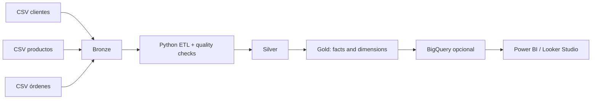

# GCP Retail Lakehouse — Medallion Architecture

Pipeline batch demostrativo para integrar datos de clientes, productos y órdenes, aplicar controles de calidad y publicar una capa analítica Gold.

## Arquitectura



## Ejecución local

Requiere Python 3.10+. No necesita paquetes externos ni una cuenta GCP.

```bash
python src/pipeline.py
```

El pipeline procesa datos sintéticos, valida claves y reglas de negocio, separa registros inválidos y genera salidas Silver/Gold y un reporte JSON de calidad.

## Capas Medallion

- **Bronze:** datos fuente originales.
- **Silver:** datos tipados, depurados y validados.
- **Gold:** hechos y agregados listos para análisis.

## Controles de calidad

- Identificador de orden único.
- Integridad referencial de clientes y productos.
- Cantidad y precio positivos.
- Consistencia entre cantidad, precio y total.
- Fecha válida y trazabilidad de rechazos.

## Estructura

- `src/pipeline.py`: ETL local.
- `data/raw/`: datos sintéticos de origen.
- `data/processed/`: salidas Silver/Gold y rechazos.
- `sql/bigquery/`: DDL y consultas analíticas.
- `reports/quality_report.json`: métricas de calidad.
- `docs/interview_notes.md`: decisiones técnicas para entrevista.

## Alcance y transparencia

El pipeline Python se ejecuta localmente. BigQuery y Cloud Storage forman parte de la arquitectura objetivo; no se afirma un despliegue productivo en GCP. Todos los datos del repositorio son sintéticos.

## Próximas mejoras

- Pruebas automatizadas con pytest.
- CI con GitHub Actions.
- Orquestación con Cloud Run Jobs o Cloud Composer.
- Particionamiento y clustering en BigQuery.
