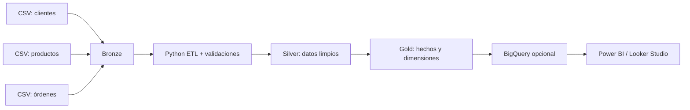

# Proyecto 1 — Retail Lakehouse con arquitectura Medallion (GCP)

## Resumen ejecutivo
Pipeline batch de ventas que integra clientes, productos y órdenes. Implementa capas **Bronze, Silver y Gold**, controles de calidad, métricas operacionales y un modelo dimensional para analítica.

**Stack:** Python 3.10+, SQL, BigQuery (SQL de despliegue), Cloud Storage (arquitectura objetivo).  
**Ejecución sin costo:** procesamiento local con Python estándar; no requiere cuenta GCP ni servicios pagos.

## Caso de negocio
Una empresa retail recibe ventas desde distintos canales. Necesita consolidar información, detectar registros duplicados o huérfanos y publicar indicadores confiables para las áreas comercial y operaciones.

## Arquitectura


## Ejecución local
Desde esta carpeta:
```bash
python src/pipeline.py
```
El pipeline genera `data/processed/silver_orders.csv`, `data/processed/gold_fact_sales.csv`, dimensiones y `reports/quality_report.json`.

No instala paquetes externos. Requiere Python 3.10 o superior.

## Reglas de calidad
- `order_id` único; duplicados se rechazan.
- Cliente y producto deben existir.
- Cantidad y precio deben ser positivos.
- `total_amount` debe coincidir con cantidad × precio.
- Fecha debe ser válida.
- Se conserva trazabilidad de filas aceptadas y rechazadas.

## Modelo analítico
- `dim_customer`: cliente, ciudad y fecha de alta.
- `dim_product`: producto, categoría y precio de referencia.
- `dim_date`: fecha y atributos calendario.
- `fact_sales`: una fila por orden válida.

## Despliegue GCP opcional
1. Crear un bucket de Cloud Storage.
2. Cargar `data/raw/` en una ruta de aterrizaje.
3. Crear un dataset BigQuery.
4. Ejecutar los SQL de `sql/bigquery/` en orden.
5. Programar el proceso con Cloud Run Jobs o Composer según volumen y frecuencia.

**Control de costos:** usar el proyecto local para entrevistas. Si se despliega, configurar presupuesto/alertas, limitar datos y eliminar recursos al terminar. La disponibilidad de cuotas gratuitas depende de la cuenta y región.

## Decisiones técnicas para explicar
- Bronze conserva el dato recibido para auditoría y reproceso.
- Silver aplica tipado, deduplicación y reglas de negocio.
- Gold publica hechos y dimensiones orientados a consumo.
- La carga es reproducible: los archivos procesados se regeneran desde los datos raw.
- En producción se agregaría particionamiento por `order_date`, clustering por `customer_id`/`product_id`, control de esquema y orquestación.

## Estructura
- `data/raw`: datos fuente ficticios.
- `src`: pipeline local.
- `sql/bigquery`: DDL y consultas analíticas.
- `reports`: resultado de calidad generado.
