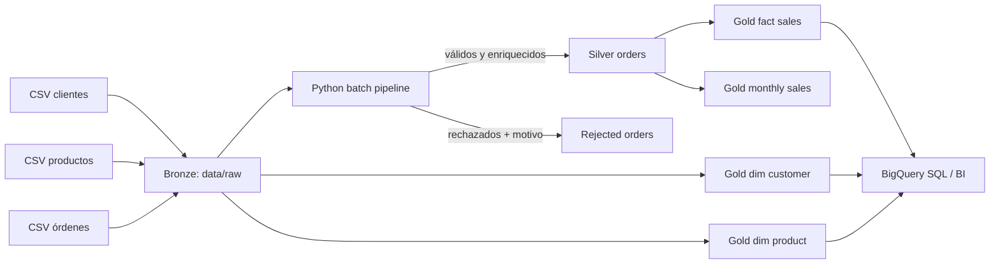

# Arquitectura y flujo de datos — GCP Medallion

## Capas
- **Bronze:** archivos CSV de origen sintéticos, conservados sin modificar.
- **Silver:** órdenes con tipos normalizados, controles de negocio e información descriptiva de clientes y productos.
- **Gold:** tabla de hechos, dimensiones conformadas y agregado mensual.
- **Rejected:** registros que no cumplen reglas, conservados con fila de origen y motivo.

## Límites de implementación
La ejecución actual es local y utiliza la biblioteca estándar de Python. BigQuery contiene DDL y consultas de referencia. No se ha creado un proyecto GCP, bucket, job, dataset ni servicio cloud.
